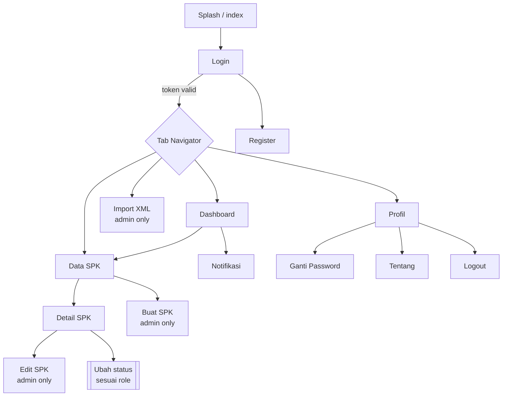
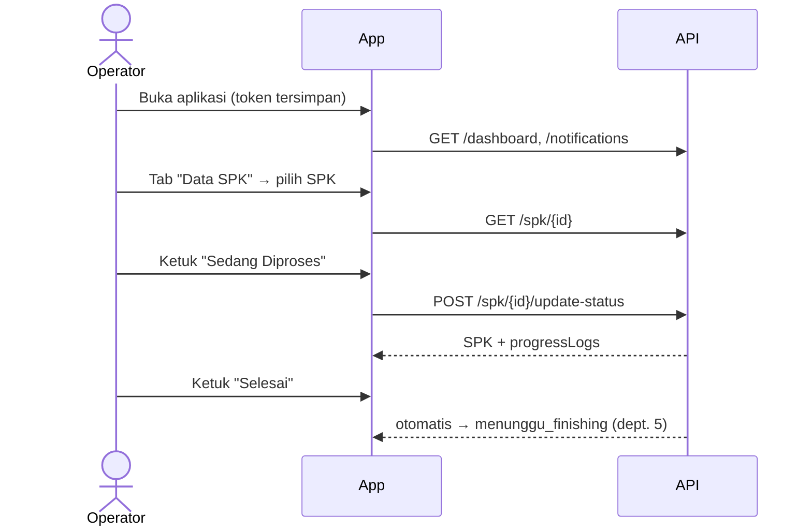
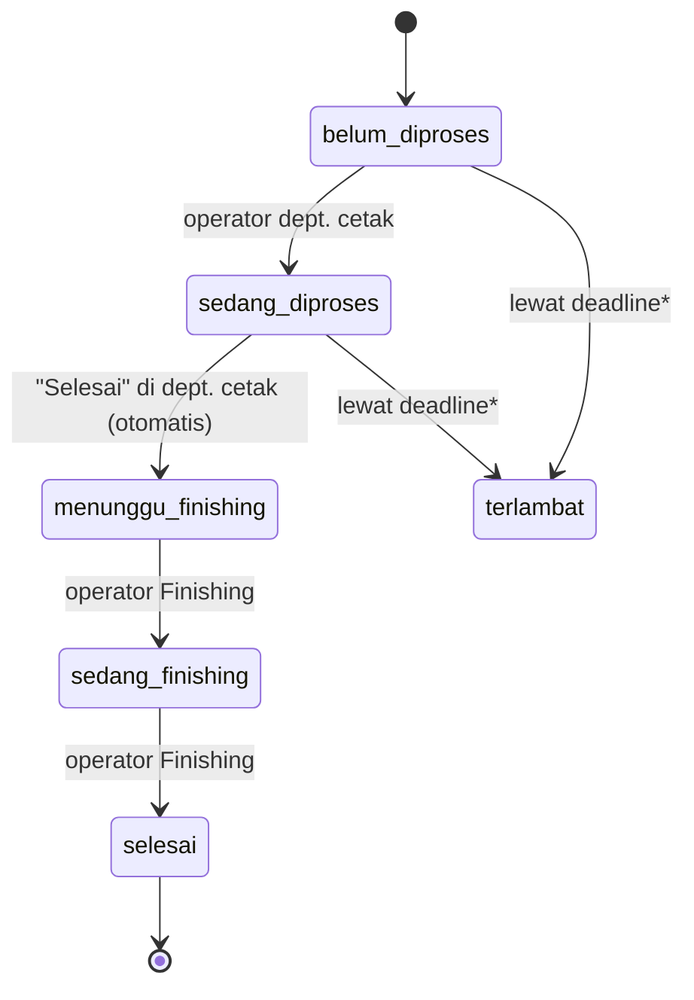

# 1. Perancangan UI/UX — ProTrack Mobile

> Dokumen ini memetakan UI/UX yang **sudah ada di kode** (`mobile/app/*`), lalu menambahkan **rekomendasi perbaikan** yang bisa ditindaklanjuti. Bagian bertanda 🆕 adalah usulan, belum diimplementasikan.

## 1.1 Konteks Produk

| Aspek | Uraian |
| :-- | :-- |
| Masalah | Status SPK (Surat Perintah Kerja) percetakan dilacak manual, sehingga sulit melihat posisi pekerjaan dan deadline antar-departemen. |
| Solusi | Aplikasi mobile untuk memantau SPK real-time, memperbarui status per departemen, dan impor data dari Accurate (XML). |
| Lingkungan pakai | Lantai produksi: satu tangan, tangan kotor/bersarung, pencahayaan bervariasi, sinyal Wi-Fi tidak selalu stabil. |
| Platform | Android & iOS (portrait), Expo Router. |

### Persona

| Persona | Tujuan utama | Frekuensi | Kebutuhan UI |
| :-- | :-- | :-- | :-- |
| **Administrator** (PPIC/admin produksi) | Membuat SPK, impor XML, memantau semua departemen | Harian, sesi panjang | Dashboard menyeluruh, filter kuat, form lengkap |
| **Operator Develop/Offset/Plotter/UV** | Melihat antrean SPK departemennya, mulai/selesaikan pekerjaan | Puluhan kali/hari, sesi pendek | Daftar sederhana, tombol status besar, minim ketikan |
| **Operator Finishing** | Menerima SPK dari cetak, menyelesaikan | Sama dengan operator | Sama, plus penanda "baru masuk dari cetak" |

**Prinsip desain turunan dari persona**
1. *Satu layar = satu tugas*; operator maksimal 2 ketukan dari buka aplikasi sampai ubah status.
2. *Informasi urgensi dulu* (deadline, prioritas), bukan data administratif.
3. *Role-aware UI*: menu yang tidak boleh diakses disembunyikan (penegakan tetap di backend).
4. *Tahan sinyal buruk*: selalu ada state loading, error, dan tarik-untuk-segarkan.

## 1.2 Information Architecture



### Inventaris layar (sesuai kode)

| Rute | File | Peran | Isi utama |
| :-- | :-- | :-- | :-- |
| `/login` | `app/login.tsx` | Semua | Email + password, tombol masuk, tautan daftar |
| `/register` | `app/register.tsx` | Publik* | Nama, email, password, pilih role |
| `/(tabs)/dashboard` | `app/(tabs)/dashboard.tsx` | Semua | Kartu statistik, bar/pie chart, 5 SPK terbaru, badge notifikasi |
| `/(tabs)/spk` → `/spk` | `app/spk/index.tsx` | Semua | Daftar SPK, pencarian, filter status/prioritas/deadline |
| `/spk/detail/[id]` | `app/spk/detail/[id].tsx` | Semua (dibatasi dept.) | Info SPK, tabel detail item, riwayat progres, aksi ubah status |
| `/spk/create` | `app/spk/create.tsx` | Admin | Form SPK + detail item dinamis |
| `/spk/edit/[id]` | `app/spk/edit/[id].tsx` | Admin | Edit deadline, prioritas, item; hapus item |
| `/(tabs)/import` → `/import` | `app/import/index.tsx` | Admin | Pilih file XML, unggah |
| `/notifications` | `app/notifications.tsx` | Semua | Daftar, tandai dibaca, hapus, baca semua |
| `/(tabs)/profile` | `app/(tabs)/profile.tsx` | Semua | Info akun, ganti password, tentang, logout |

\* Lihat catatan keamanan di dokumen 3 (§3.7): registrasi publik dengan pemilihan role sebaiknya dibatasi.

## 1.3 Alur Pengguna Utama

### A. Operator memperbarui status (alur paling sering)


### B. Admin membuat SPK
`Data SPK` → **+ Buat SPK** → pilih/ketik customer → departemen → tanggal & deadline → prioritas → tambah item (file, bahan, P×L, qty, finishing) → Simpan → notifikasi "SPK Baru Dibuat".

### C. Admin impor XML Accurate
`Import XML` → pilih file → unggah → hasil: berhasil (`spk_id`) / duplikat / departemen tidak terdeteksi → buka detail SPK.

### Siklus status SPK

\* `terlambat` saat ini dihitung dinamis dari `deadline_date`, bukan status tersimpan (lihat dokumen 3 §3.7).

## 1.4 Design System (dari `src/styles/colors.js`)

### Token warna
| Token | Hex | Pemakaian |
| :-- | :-- | :-- |
| `primary` / `primaryDark` / `primaryLight` | `#2563EB` / `#1E40AF` / `#EFF6FF` | Aksi utama, tab aktif, status "Diproses" |
| `success` / `successLight` | `#16A34A` / `#DCFCE7` | Selesai |
| `warning` / `warningLight` | `#EA580C` / `#FFEDD5` | Menunggu Finishing, high priority |
| `danger` / `dangerLight` | `#DC2626` / `#FEE2E2` | Terlambat, urgent, hapus |
| `info` / `infoLight` | `#0284C7` / `#E0F2FE` | Sedang Finishing |
| `purple` | `#7C3AED` | Aksen grafik |
| `background` / `card` / `text` / `textMuted` / `border` | `#F8FAFC` / `#FFFFFF` / `#0F172A` / `#64748B` / `#E2E8F0` | Permukaan & teks |

### Pemetaan status → badge (konsisten di semua layar)
| Status | Label | Warna |
| :-- | :-- | :-- |
| `belum_diproses` | Belum Diproses | abu (`textMuted` / `borderLight`) |
| `sedang_diproses` | Diproses | biru |
| `menunggu_finishing` | Tunggu Finishing | oranye |
| `sedang_finishing` | Finishing | cyan |
| `selesai` | Selesai | hijau |
| `terlambat` | Terlambat | merah |

### Komponen yang perlu distandarkan 🆕
Saat ini fungsi badge status, kartu SPK, dan gaya `StyleSheet` diulang di tiap layar (layar berukuran 300–830 baris). Ekstrak ke komponen bersama:

`StatusBadge`, `PriorityBadge`, `SpkCard`, `StatCard`, `EmptyState`, `ErrorState`, `ScreenHeader`, `FormField`, `PrimaryButton`, `ConfirmDialog`.

### Tipografi, jarak, sentuh 🆕
| Item | Usulan |
| :-- | :-- |
| Skala font | 12 (caption) · 14 (body) · 16 (body-lg) · 18 (title) · 24 (headline) |
| Grid jarak | Kelipatan 4 (4/8/12/16/24/32) |
| Target sentuh | **≥ 48 dp**, khusus tombol status operator **≥ 56 dp** (tangan bersarung) |
| Radius | 12 untuk kartu, 10 untuk input/tombol |

## 1.5 Wireframe Layar Kunci (low-fidelity)

**Dashboard (admin)**
```
┌───────────────────────────────┐
│ Halo, Administrator      🔔(3)│
├───────────────────────────────┤
│ [Total 42] [Proses 12]        │
│ [Terlambat 3 ⚠] [Besok 5]     │
│ [Urgent 4]   [Selesai 20]     │
├───────────────────────────────┤
│ Status SPK        (bar chart) │
│ Per Departemen    (pie chart) │
├───────────────────────────────┤
│ SPK Terbaru                   │
│ ▸ SPK/26/06/0042  PT Maju  ● │
│ ▸ SPK/26/06/0041  CV Jaya  ● │
└──[Dashboard][SPK][Import][Profil]
```

**Daftar SPK**
```
┌───────────────────────────────┐
│ 🔍 Cari no SPK / customer     │
│ (Semua)(Proses)(Tunggu)(Telat)│  ← chip horizontal
├───────────────────────────────┤
│ SPK/26/06/0042       [URGENT] │
│ PT Maju Jaya · Plotter        │
│ Deadline 08 Jun   ● Diproses  │
├───────────────────────────────┤
│ ...                           │
└───────────────────────[+ SPK]─┘   ← FAB hanya admin
```

**Detail SPK (operator)**
```
┌ ← SPK/26/06/0042    [URGENT] ┐
│ PT Maju Jaya · Plotter       │
│ Deadline: 08 Jun (2 hari)    │
├──────────────────────────────┤
│ Item (3)                     │
│  Banner_A.pdf  Flexi 280g    │
│  3.0 × 1.0 m   Qty 10  Mata  │
├──────────────────────────────┤
│ Riwayat                      │
│  ○ 06/06 09:10 Plotter → ... │
├──────────────────────────────┤
│ [   MULAI KERJA   ] (56dp)   │
│ [     SELESAI     ]          │
└──────────────────────────────┘
```
Tombol status **hanya menampilkan transisi yang diizinkan** untuk role tersebut (`allowedStatuses()` di `src/services/rbac.ts`).

## 1.6 Evaluasi Heuristik & Rekomendasi

Dievaluasi dengan 10 heuristik Nielsen terhadap kode saat ini.

| # | Temuan | Dampak | Rekomendasi | Prioritas |
| :-: | :-- | :-- | :-- | :-: |
| 1 | Tidak ada indikator **offline/sinyal buruk**; timeout 15 dtk lalu gagal senyap (`console.log`) | Operator tidak tahu data basi | Banner "Offline" + tombol *Coba lagi*; tampilkan waktu sinkron terakhir | Tinggi |
| 2 | Perubahan status langsung terkirim tanpa konfirmasi | Salah ketuk "Selesai" memindahkan SPK ke Finishing | Dialog konfirmasi + *Undo* 5 dtk (snackbar) | Tinggi |
| 3 | Deadline ditampilkan sebagai tanggal mentah | Sulit menilai urgensi cepat | Tampilkan "2 hari lagi / terlambat 1 hari" + warna | Tinggi |
| 4 | Notifikasi deadline dijanjikan di README, tetapi scheduler Laravel kosong | Fitur "peringatan otomatis" tidak berjalan | Implementasi job terjadwal (dok. 3 §3.8) + push notification | Tinggi |
| 5 | Daftar SPK tanpa paginasi/skeleton | Lambat saat data ribuan | *Infinite scroll* + skeleton loader | Sedang |
| 6 | Form `create`/`edit` 800+ baris, validasi sisi klien minim | Salah input, pesan error generik | Validasi per-field inline (react-hook-form + zod), tampilkan error 422 dari server per-field | Sedang |
| 7 | Warna sebagai satu-satunya pembeda status | Kurang aksesibel (buta warna) | Tambah ikon pada badge (✓, ⏱, ⚠) | Sedang |
| 8 | Tidak ada dark mode meski `userInterfaceStyle: "automatic"` | Inkonsisten dengan setelan OS | Siapkan token tema terang/gelap | Rendah |
| 9 | Empty state tidak jelas (daftar kosong) | Pengguna bingung | Ilustrasi + teks aksi ("Belum ada SPK. Impor XML?") | Rendah |
| 10 | Tab `Import` disembunyikan via `href: null` setelah baca AsyncStorage → *flicker* saat awal | Menu berkedip | Simpan user di context/store sehingga role tersedia sinkron | Sedang |

### Aksesibilitas (target WCAG 2.1 AA) 🆕
- Kontras teks ≥ 4.5:1 (periksa `textMuted #64748B` di atas `borderLight #F1F5F9` ≈ 4.4:1 → gelapkan sedikit).
- `accessibilityLabel` pada semua tombol ikon (lonceng, hapus, FAB).
- Dukungan *Dynamic Type*: hindari tinggi tetap pada teks.

### Microcopy (Bahasa Indonesia) 🆕
| Situasi | Teks |
| :-- | :-- |
| Konfirmasi selesai | "Tandai SPK/26/06/0042 selesai? SPK akan diteruskan ke Finishing." |
| Gagal jaringan | "Tidak dapat terhubung ke server. Periksa Wi-Fi Anda, lalu coba lagi." |
| Akses ditolak | "SPK ini bukan bagian dari departemen Anda." *(sudah dipakai di backend)* |
| Kosong | "Belum ada SPK untuk departemen Anda." |

## 1.7 Pro & Kontra Pendekatan UI

| Keputusan | Pro | Kontra |
| :-- | :-- | :-- |
| **Bottom tab** (4 tab) | Mudah dijangkau satu tangan, pola familiar | Tab "Import" hanya relevan admin → ruang terbuang untuk operator (sudah disembunyikan) |
| **Role-aware UI** (sembunyikan menu) | Antarmuka bersih per role | Harus sinkron dengan backend; sebaiknya dari satu sumber (`GET /user` mengembalikan `abilities`) |
| **Dashboard grafik** (chart-kit) | Gambaran cepat | `react-native-chart-kit` tidak dirawat aktif & kurang aksesibel; pertimbangkan `victory-native`/`react-native-gifted-charts` bila butuh interaksi |
| **Form panjang satu layar** | Sederhana | Rentan salah input di layar kecil → pecah menjadi *stepper* (Info → Item → Tinjau) |

## 1.8 Rekomendasi Roadmap UI/UX

1. **Sprint 1**: komponen bersama (`StatusBadge`, `SpkCard`), konfirmasi status, deadline relatif, state error/offline.
2. **Sprint 2**: paginasi + skeleton, validasi form inline, stepper pembuatan SPK.
3. **Sprint 3**: push notification deadline, aksesibilitas, dark mode.
4. **Validasi**: uji kegunaan dengan 3–5 operator nyata (tugas: "ubah SPK X menjadi selesai" — ukur waktu & salah ketuk) sebelum rilis.
