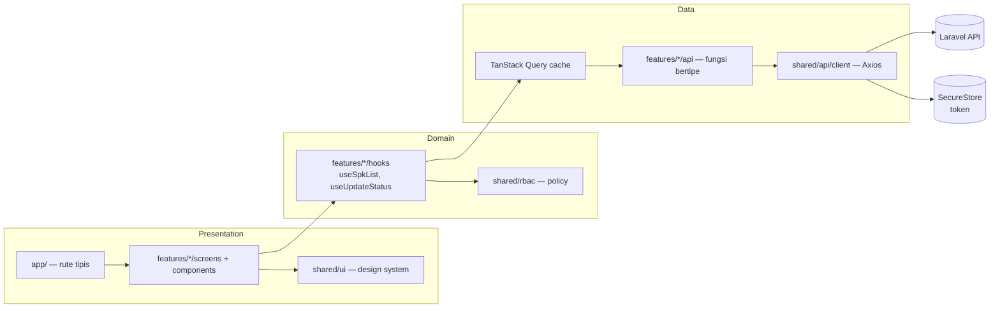

# 2. Perancangan Arsitektur React Native & Struktur Proyek

> Mencakup kondisi **saat ini** (`mobile/`), lalu **arsitektur target** yang direkomendasikan beserta rencana migrasi bertahap. Bagian 🆕 = usulan.

## 2.1 Kondisi Saat Ini

| Aspek | Kondisi |
| :-- | :-- |
| Framework | Expo SDK 57, React Native 0.86, React 19.2, New Architecture aktif, React Compiler aktif |
| Navigasi | Expo Router (file-based), `typedRoutes: true` |
| HTTP | Axios, instance tunggal `src/services/api.js` dengan interceptor token & 401 |
| State | `useState` lokal per layar; tidak ada store/cache global |
| Penyimpanan | `AsyncStorage` (token & user JSON) |
| Bahasa | Campuran TS (`.tsx`) dan JS (`api.js`, `colors.js`) |
| Chart | `react-native-chart-kit` + `react-native-svg` |
| Pengujian | Belum ada (hanya `expo lint`) |

### Struktur saat ini
```
mobile/
├── app/                       # Rute (Expo Router)
│   ├── _layout.tsx            # Stack tanpa header
│   ├── index.tsx              # Redirect → /login
│   ├── login.tsx · register.tsx · change-password.tsx · about.tsx · notifications.tsx
│   ├── (tabs)/                # dashboard · spk · import · profile (re-export)
│   ├── spk/                   # index · create · detail/[id] · edit/[id]
│   └── import/index.tsx
└── src/
    ├── services/ api.js · rbac.ts
    └── styles/colors.js
```

### Pengamatan arsitektural
| # | Temuan | Risiko |
| :-: | :-- | :-- |
| 1 | Layar berisi UI + fetch + logika bisnis dalam satu file (300–830 baris) | Sulit diuji & dirawat, duplikasi (badge status disalin di beberapa layar) |
| 2 | `index.tsx` selalu `Redirect → /login`; sesi tersimpan baru dicek di layar login | Kedipan layar login; tidak ada *auth gate* terpusat |
| 3 | Role dibaca dari AsyncStorage di `(tabs)/_layout.tsx` setelah render pertama | Menu berkedip; role tidak tersedia sinkron di layar lain |
| 4 | Token di `AsyncStorage` (tidak terenkripsi) | Risiko pencurian token di perangkat *rooted* |
| 5 | URL API dari deteksi IP Metro + fallback IP hard-coded `10.113.254.2`, `http://` | Tidak bisa dipakai di build produksi; cleartext traffic |
| 6 | `(tabs)/spk.tsx` & `(tabs)/import.tsx` hanya `export { default } from "../spk"` | Berfungsi, namun menyebar logika rute; lebih rapi memindahkan layar ke dalam grup tab |
| 7 | Tipe respons API tidak didefinisikan (`any` implisit), duplikasi `rbac.ts` vs backend | Drift kontrak API |
| 8 | Tidak ada cache/refetch strategy; `useFocusEffect` memanggil ulang manual | Data berulang diunduh, tidak ada *stale-while-revalidate* |

## 2.2 Arsitektur Target

Pendekatan: **feature-sliced + layered ringan**. Rute (`app/`) hanya *tipis* — merakit komponen dari `src/features/*`. Logika data lewat **TanStack Query**, state sesi lewat **Zustand/Context**, kontrak API bertipe.



### Struktur proyek yang direkomendasikan 🆕
```
mobile/
├── app/                              # HANYA rute & layout (tipis)
│   ├── _layout.tsx                   # Provider: QueryClient, AuthProvider, Theme
│   ├── (auth)/
│   │   ├── _layout.tsx               # redirect bila sudah login
│   │   ├── login.tsx
│   │   └── register.tsx
│   ├── (app)/                        # grup terproteksi (auth gate di _layout)
│   │   ├── _layout.tsx               # cek sesi; <Redirect href="/login"/> bila tidak ada
│   │   ├── (tabs)/
│   │   │   ├── _layout.tsx
│   │   │   ├── dashboard.tsx
│   │   │   ├── spk/index.tsx
│   │   │   ├── import.tsx
│   │   │   └── profile.tsx
│   │   ├── spk/
│   │   │   ├── create.tsx
│   │   │   └── [id]/ index.tsx · edit.tsx
│   │   ├── notifications.tsx
│   │   └── change-password.tsx
│   └── +not-found.tsx
├── src/
│   ├── features/
│   │   ├── auth/      { api.ts, hooks.ts, store.ts, schemas.ts, components/ }
│   │   ├── dashboard/ { api.ts, hooks.ts, components/StatCard.tsx, StatusChart.tsx }
│   │   ├── spk/       { api.ts, hooks.ts, types.ts, schemas.ts, components/ SpkCard, SpkForm, DetailRow, StatusActions }
│   │   ├── import/    { api.ts, hooks.ts }
│   │   └── notifications/ { api.ts, hooks.ts, components/ }
│   ├── shared/
│   │   ├── api/       { client.ts, errors.ts, queryClient.ts }
│   │   ├── ui/        { Button, Badge, Card, Input, EmptyState, ErrorState, Skeleton, ConfirmDialog }
│   │   ├── theme/     { colors.ts, spacing.ts, typography.ts }
│   │   ├── rbac/      { policy.ts }       # satu sumber kebenaran izin di klien
│   │   ├── config/    { env.ts }          # EXPO_PUBLIC_API_URL
│   │   └── utils/     { date.ts, format.ts }
│   └── types/ api.d.ts                    # tipe hasil generate dari OpenAPI (opsional)
├── __tests__/                             # Jest + RNTL
├── .env.development · .env.production     # EXPO_PUBLIC_API_URL
└── app.config.ts                          # menggantikan app.json (konfigurasi dinamis)
```

**Aturan dependensi**: `app/` → `features/` → `shared/`. `features/a` tidak mengimpor `features/b` (lewat `shared` bila perlu). `shared/` tidak mengimpor `features/`.

## 2.3 Keputusan Arsitektur (ADR ringkas)

### ADR-1: Server state → TanStack Query
| Pro | Kontra |
| :-- | :-- |
| Cache, dedup request, *refetch on focus/reconnect*, retry, status `isLoading/isError` standar | Dependensi baru, kurva belajar singkat |
| Mutasi + *optimistic update* untuk ubah status (terasa instan di sinyal lemah) | Perlu disiplin *query key* |
| Menghapus banyak `useState`/`useEffect` boilerplate | — |

**Alternatif**: SWR (lebih ringan, mutasi kurang kaya), Redux Toolkit Query (berat bagi skala ini). **Rekomendasi: TanStack Query.**

### ADR-2: Client state (sesi, preferensi) → Zustand
| Pro | Kontra |
| :-- | :-- |
| Minim boilerplate, tanpa Provider, mudah diuji | Satu lib tambahan |
| Cocok untuk `user`, `token`, `hydrated` | Tak untuk server state |

**Alternatif**: React Context (cukup untuk sesi saja, tetapi re-render lebih luas). **Rekomendasi: Zustand** (atau Context bila ingin nol dependensi).

### ADR-3: Penyimpanan token → `expo-secure-store`
| Pro | Kontra |
| :-- | :-- |
| Keychain/Keystore terenkripsi | Batas ukuran nilai (~2 KB) — cukup untuk token Sanctum |
| Standar industri untuk kredensial | Tidak tersedia di web (bukan target) |

Simpan **hanya token** di SecureStore; profil user cukup di memori + `GET /user` saat *hydrate*.

### ADR-4: Konfigurasi URL API → env, bukan deteksi IP
Ganti `getHostIp()` dengan `process.env.EXPO_PUBLIC_API_URL` per lingkungan (`dev`: `http://<ip-lan>:8000/api`; `prod`: `https://api.<domain>/api`). Pro: build produksi dapat dipakai, HTTPS. Kontra: dev perlu mengatur `.env` (bisa dibantu skrip). Untuk dev, deteksi IP boleh dipertahankan sebagai *fallback* saat `__DEV__`.

### ADR-5: TypeScript penuh
Konversi `api.js` & `colors.js` ke `.ts`; aktifkan `strict`. Tipe domain (`Spk`, `SpkDetail`, `Status`, `Role`) berada di `features/spk/types.ts` dan **diturunkan dari kontrak API** (dok. 3). Pro: bug kontrak tertangkap saat kompilasi. Kontra: biaya migrasi awal.

### ADR-6: Validasi form → react-hook-form + zod
Pro: validasi deklaratif, skema dipakai ulang untuk tipe; error 422 server dipetakan ke field. Kontra: dependensi tambahan. Menggantikan state form manual di `create.tsx`/`edit/[id].tsx`.

### ADR-7: Chart
`react-native-chart-kit` cukup untuk MVP; jika butuh sentuhan/animasi/aksesibilitas, migrasi ke `victory-native` (Skia). Keputusan ditunda sampai ada kebutuhan nyata.

## 2.4 Contoh Kode Pola Target

**`shared/api/client.ts`** — klien dengan token dari SecureStore dan error ternormalisasi
```ts
import axios, { AxiosError } from "axios";
import * as SecureStore from "expo-secure-store";
import { env } from "../config/env";
import { useAuthStore } from "../../features/auth/store";

export const client = axios.create({
  baseURL: env.apiUrl,
  timeout: 15_000,
  headers: { Accept: "application/json" },
});

client.interceptors.request.use(async (config) => {
  const token = await SecureStore.getItemAsync("token");
  if (token) config.headers.Authorization = `Bearer ${token}`;
  return config;
});

client.interceptors.response.use(undefined, (error: AxiosError) => {
  if (error.response?.status === 401) useAuthStore.getState().signOut();
  return Promise.reject(error);
});
```

**`features/spk/hooks.ts`** — query & mutasi dengan optimistic update
```ts
export const spkKeys = {
  all: ["spk"] as const,
  list: (f: SpkFilters) => [...spkKeys.all, "list", f] as const,
  detail: (id: number) => [...spkKeys.all, "detail", id] as const,
};

export function useSpkList(filters: SpkFilters) {
  return useInfiniteQuery({
    queryKey: spkKeys.list(filters),
    queryFn: ({ pageParam = 1 }) => spkApi.list({ ...filters, page: pageParam }),
    getNextPageParam: (last) => last.meta.next_page ?? undefined,
    initialPageParam: 1,
  });
}

export function useUpdateStatus(id: number) {
  const qc = useQueryClient();
  return useMutation({
    mutationFn: (p: { status: Status; catatan?: string }) => spkApi.updateStatus(id, p),
    onSuccess: (spk) => {
      qc.setQueryData(spkKeys.detail(id), spk);
      qc.invalidateQueries({ queryKey: spkKeys.all });
      qc.invalidateQueries({ queryKey: ["dashboard"] });
    },
  });
}
```

**`app/(app)/_layout.tsx`** — auth gate terpusat (menghapus kedipan login & role)
```tsx
export default function AppLayout() {
  const { hydrated, user } = useAuthStore();
  if (!hydrated) return <SplashScreen />;       // tunggu baca SecureStore + GET /user
  if (!user) return <Redirect href="/login" />;
  return <Stack screenOptions={{ headerShown: false }} />;
}
```

**`shared/rbac/policy.ts`** — satu sumber izin sisi klien
```ts
export const can = {
  createSpk: (u: User) => u.role === "admin",
  importXml: (u: User) => u.role === "admin",
  setStatus: (u: User, s: Status) => allowedStatuses(u.role).includes(s),
};
```
> Saran lanjutan: backend mengembalikan `abilities` pada login/`GET /user` agar aturan tidak ditulis dua kali (`rbac.ts` kini harus dijaga sinkron manual dengan `User::allowedStatuses()`).

## 2.5 Lintas-Aspek

| Topik | Rekomendasi |
| :-- | :-- |
| **Offline** | `@tanstack/query-async-storage-persister` untuk cache baca; `NetInfo` untuk banner offline. Antrean mutasi offline ditunda (risiko konflik status antar operator). |
| **Push notification** | `expo-notifications` + endpoint `POST /devices` (simpan Expo push token). Dibutuhkan agar notifikasi deadline sampai tanpa app dibuka. |
| **Error boundary** | `ErrorBoundary` per grup rute (`export function ErrorBoundary` di Expo Router) + pelaporan (Sentry). |
| **Keamanan** | HTTPS, SecureStore, jangan log token/URL ke `console.log` pada produksi, `android:usesCleartextTraffic=false` di build produksi. |
| **Performa** | `FlatList` + `keyExtractor`/`getItemLayout` untuk daftar SPK, paginasi server, `expo-image` bila ada gambar. React Compiler sudah aktif — hindari `useMemo/useCallback` manual yang tidak perlu. |
| **Build & rilis** | EAS Build (`eas.json`: profil `development`, `preview`, `production`), EAS Update untuk OTA, versi dari `app.config.ts`. |
| **Kualitas** | ESLint (sudah), `tsc --noEmit` di CI, Jest + React Native Testing Library, Maestro/Detox untuk 1–2 alur E2E (login → ubah status). |
| **CI/CD** | GitHub Actions: lint + typecheck + test pada PR; EAS Build pada tag. |

## 2.6 Rencana Migrasi Bertahap (tanpa *big-bang*)

| Tahap | Pekerjaan | Hasil | Risiko |
| :-: | :-- | :-- | :-: |
| 0 | Tambah `tsc --noEmit` & Jest ke CI; buat `.env` + `env.ts`; ganti `console.log(BASE_URL)` | Fondasi aman | Rendah |
| 1 | Pindah ke `src/shared/theme`, ekstrak `StatusBadge`, `SpkCard`, `StatCard`; hapus duplikasi | UI konsisten | Rendah |
| 2 | `expo-secure-store` + `AuthProvider/Zustand` + grup `(auth)`/`(app)` dengan auth gate | Tak ada kedipan; token aman | Sedang |
| 3 | TanStack Query: mulai dari `dashboard` & `spk/index` (baca), lalu mutasi status | Cache + loading/error seragam | Sedang |
| 4 | Pecah `create`/`edit` (800 baris) → `SpkForm` + react-hook-form/zod | Form maintainable | Sedang |
| 5 | Paginasi (butuh perubahan API — dok. 3), push notification, offline cache | Skalabel | Tinggi (koordinasi backend) |

## 2.7 Pro & Kontra Keseluruhan Arsitektur Target

| | Pro | Kontra |
| :-- | :-- | :-- |
| Skalabilitas | Fitur terisolasi; tim dapat bekerja paralel | Struktur lebih banyak folder untuk aplikasi 10 layar |
| Keamanan | Token terenkripsi, HTTPS via env, auth gate | Perlu pengaturan EAS/env |
| Efisiensi dev | Hook bertipe, cache otomatis, komponen dipakai ulang | Investasi migrasi 2–3 sprint |
| Risiko | Bertahap, tiap tahap bisa dirilis | Selama transisi dua pola hidup berdampingan |

**Kesimpulan**: untuk tim kecil dengan 10 layar, **jangan** menambah Redux/Clean Architecture penuh. Rekomendasi minimal bernilai tinggi: **(1)** SecureStore + auth gate, **(2)** TanStack Query, **(3)** ekstraksi komponen bersama + TypeScript penuh, **(4)** konfigurasi URL via env. Sisanya bertahap sesuai kebutuhan.
