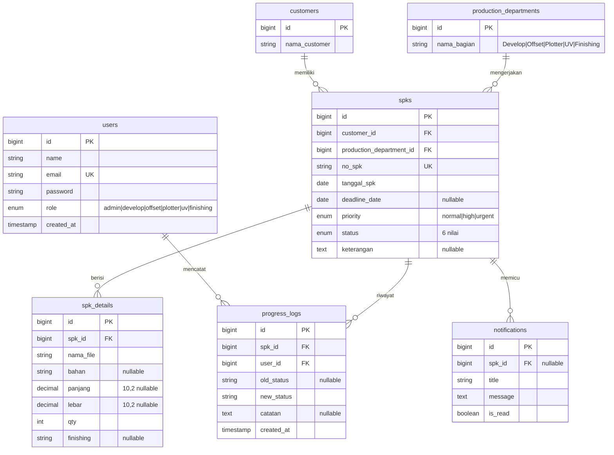
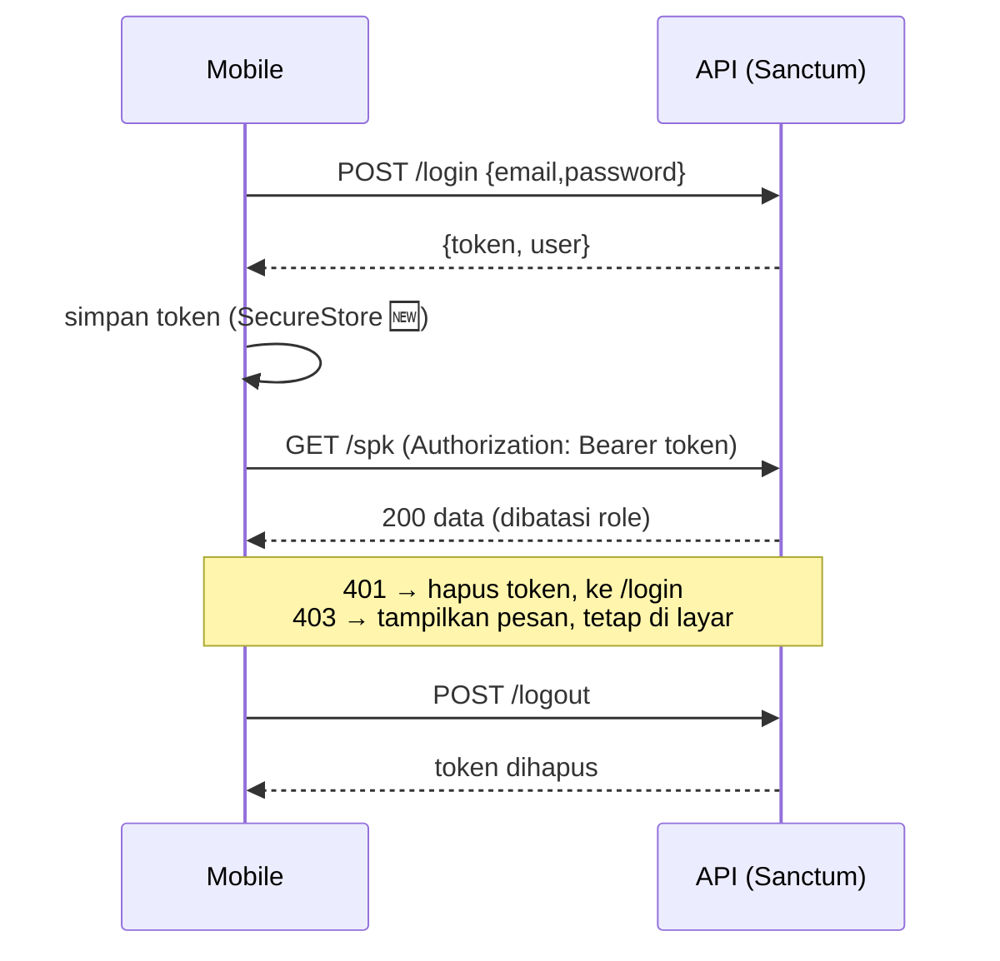
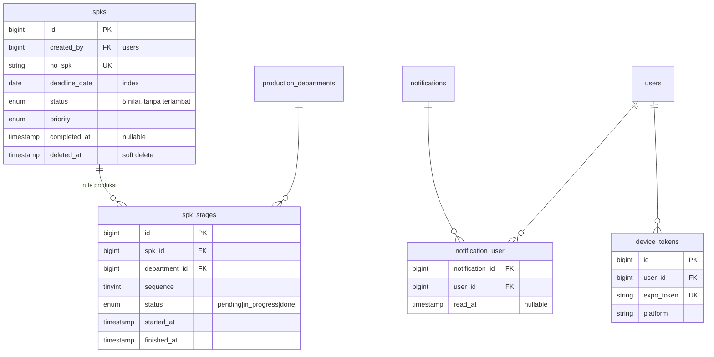

# 3. Perancangan REST API & Struktur Data

> Bagian 3.1–3.6 mendokumentasikan **kontrak yang berjalan saat ini** (diturunkan dari `backend/routes/api.php`, controller, dan migrasi). Bagian 3.7–3.10 berisi **temuan** dan **desain target (v2)**. Bagian 🆕 = usulan.

## 3.1 Gambaran Umum

| Aspek | Nilai |
| :-- | :-- |
| Framework | Laravel + Laravel Sanctum (token Bearer) |
| Base URL | `{host}/api` |
| Format | JSON (`Accept: application/json`), kecuali unggah XML (`multipart/form-data`) |
| Autentikasi | `Authorization: Bearer <token>` dari `POST /login` |
| Otorisasi | Middleware `role:admin` + pembatasan departemen di controller (`User::canAccessSpk`, `allowedStatuses`) |
| Basis data | MySQL/MariaDB |

## 3.2 Model Data

### ERD

Semua FK memakai `ON DELETE CASCADE`. `users` juga memiliki `personal_access_tokens` (Sanctum).

### Kamus data penting
| Entitas.Field | Aturan |
| :-- | :-- |
| `spks.no_spk` | Unik. Dibuat sistem `SPK/{yy}/{mm}/{0000}`; pada impor XML memakai `INVOICENO` Accurate |
| `spks.status` | `belum_diproses` → `sedang_diproses` → `menunggu_finishing` → `sedang_finishing` → `selesai`; `terlambat` |
| `spks.priority` | `normal` · `high` · `urgent` |
| `spk_details.panjang/lebar` | Dalam **cm** (label form `Panjang (cm)`/`Lebar (cm)` dan tampilan detail; belum ditegakkan di skema). Perlu dipastikan XML Accurate (`ITEMRESERVED2/3`) memakai satuan yang sama. |
| `User::DEPARTMENT_BY_ROLE` | `develop=1, offset=2, plotter=3, uv=4, finishing=5` — **ID departemen di-hardcode**, harus cocok dengan seeder |

## 3.3 Matriks Hak Akses

| Endpoint | Admin | Operator cetak | Operator Finishing |
| :-- | :-: | :-: | :-: |
| Login/Logout/Ganti password | ✅ | ✅ | ✅ |
| `GET /dashboard`, `/spk`, `/notifications` | Semua | Dept. sendiri | Dept. Finishing |
| `GET /spk/{id}` | ✅ | Dept. sendiri | Dept. Finishing |
| `POST /spk/{id}/update-status` | Semua status | `sedang_diproses`, `selesai` | `sedang_finishing`, `selesai` |
| `POST /spk/store`, `/spk/{id}/update`, `DELETE /spk-detail/{id}`, `POST /import-xml` | ✅ | ❌ 403 | ❌ 403 |

## 3.4 Referensi Endpoint (v1 — berjalan saat ini)

### Konvensi respons saat ini
Sukses: `{ "success": true, "message": "...", ... }` **atau** objek/array mentah (mis. `/spk`, `/customers`). Galat otorisasi: `{ "success": false, "message": "..." }` (401/403). Galat validasi: format bawaan Laravel `{ "message", "errors": {...} }` (422). *(Tidak konsisten — lihat §3.7.)*

### Autentikasi

| Method & Path | Auth | Body | Respons |
| :-- | :-: | :-- | :-- |
| `POST /login` | – | `email`, `password` | 200 `{ success, token, user{ id,name,email,role,role_label,department_id } }` · 401 kredensial salah |
| `POST /register` | – | `name`, `email`, `password`, `password_confirmation`, `role` | 201 `{ success, user }` · 403 bila `role=admin` dan pemanggil bukan admin · 422 |
| `POST /logout` | ✅ | – | 200, token saat ini dihapus |
| `POST /change-password` | ✅ | `old_password`, `new_password`, `new_password_confirmation` (min 6) | 200 · 422 password lama salah |
| `GET /user` | ✅ | – | Model user (tanpa `password`) |

### Dashboard
`GET /dashboard` → statistik (dibatasi departemen untuk operator):
```json
{
  "totalSpk": 42, "belumDiproses": 10, "sedangDiproses": 12,
  "menungguFinishing": 3, "sedangFinishing": 2, "selesai": 15,
  "spkTerlambat": 3, "deadlineBesok": 5, "urgent": 4,
  "statusChart": [10, 12, 3, 2, 15, 3],
  "departmentChart": [8, 11, 9, 6, 8],
  "latestSpks": [ { "id": 42, "no_spk": "SPK/26/06/0042", "status": "sedang_diproses",
                    "customer": { "nama_customer": "PT Maju" }, "department": { "nama_bagian": "Plotter" } } ]
}
```
Urutan `statusChart` = [belum, proses, menunggu finishing, sedang finishing, selesai, terlambat]; `departmentChart` = ID 1–5.

### SPK

**`GET /spk`** — query opsional:

| Param | Contoh | Keterangan |
| :-- | :-- | :-- |
| `search` | `maju` | LIKE pada `no_spk`, `priority`, `status`, `deadline_date`, nama customer |
| `status` | `terlambat` | `terlambat` = deadline lewat & belum selesai (dihitung dinamis); lainnya cocok persis |
| `deadline` | `besok` | Deadline = besok & belum selesai |
| `department`, `priority`, `customer` | `3`, `urgent`, `7` | Filter ID/nilai |
| `sort`, `direction` | `deadline_date`, `asc` | Default `created_at desc`; `customer` & `department` mengurut via join |

Respons: **array** SPK (dengan `customer`, `department`) — *tanpa paginasi*.

**`GET /spk/{id}`** → SPK + `customer`, `department`, `details[]`, `progress_logs[]{…, user}`. 403 bila bukan departemen operator, 404 bila tidak ada.

**`POST /spk/{id}/update-status`** — body `{ "status": "...", "catatan": "opsional" }`
- 422 bila status di luar enum; 403 bila role tidak boleh men-set status itu / SPK bukan miliknya.
- Aturan khusus: operator cetak mengirim `selesai` → server mengubah `status=menunggu_finishing` **dan** `production_department_id=5`, mencatat log "Otomatis dikirim ke Finishing".
- Respons: `{ success, message, spk{…relasi} }`. Membuat `progress_logs` (+ notifikasi pada jalur biasa).

**`POST /spk/store`** *(admin)* — body:
```json
{
  "customer_id": 7,                       // ATAU "nama_customer": "PT Baru" (firstOrCreate)
  "production_department_id": 3,
  "tanggal_spk": "2026-06-07",
  "deadline_date": "2026-06-14",
  "priority": "high",
  "keterangan": "Banner event",
  "details": [ { "nama_file": "banner.pdf", "bahan": "Flexi 280", "panjang": 300, "lebar": 100, "qty": 10, "finishing": "Mata ayam" } ]
}
```
201 `{ success, message, data }`. Status awal `belum_diproses`; `no_spk` dibuat server; membuat notifikasi "SPK Baru Dibuat".

**`POST /spk/{id}/update`** *(admin)* — `deadline_date`, `priority`, `details[]` (dengan `id`, untuk ubah), `newItems[]` (tambah). **`DELETE /spk-detail/{id}`** *(admin)*.

### Master data
`GET /customers` (urut nama), `GET /departments` (urut nama) → array.

### Notifikasi
| Method & Path | Keterangan |
| :-- | :-- |
| `GET /notifications` | `{ success, unread_count, data[] }` — 50 terbaru, dibatasi departemen untuk operator |
| `POST /notifications/{id}/read` | Tandai dibaca |
| `POST /notifications/read-all` | Tandai semua (dalam lingkup role) |
| `DELETE /notifications/{id}` | Hapus |

### Impor XML *(admin)*
`POST /import-xml` — `multipart/form-data`, field `xml_file`. Memetakan `TRANSACTIONS/DELIVERYORDER`:

| XML Accurate | Kolom |
| :-- | :-- |
| `INVOICENO` | `spks.no_spk` (unik → 422 "SPK sudah pernah diimport") |
| `SHIPTO1` | `customers.nama_customer` (firstOrCreate) |
| `DESCRIPTION` (mengandung `DEVELOP/OFFSET/PLOTTER/UV/FINISHING`) | departemen; tak cocok → 422; juga `keterangan` |
| `ITEMLINE/ITEMRESERVED1,ITEMOVDESC,ITEMRESERVED2,ITEMRESERVED3,QUANTITY,ITEMRESERVED6` | `nama_file, bahan, panjang, lebar, qty, finishing` |

## 3.5 Alur Autentikasi


## 3.6 Aturan Bisnis Terkode
1. **Isolasi departemen**: operator hanya melihat/mengubah SPK dengan `production_department_id` = departemennya (list, detail, dashboard, notifikasi, update-status).
2. **Hand-off otomatis** cetak → Finishing saat `selesai`.
3. **Audit**: setiap perubahan status mencatat `progress_logs` (siapa, dari→ke, catatan, waktu).
4. **Duplikasi impor** dicegah lewat `no_spk` unik.
5. **Akun admin** hanya dapat dibuat oleh admin yang sedang login.

Pengujian: `backend/tests/Feature/RbacTest.php` mencakup autentikasi & RBAC.

---

## 3.7 Temuan & Risiko pada Implementasi Saat Ini

Diurutkan menurut dampak. Semua diverifikasi dari kode di repo.

| # | Sev. | Temuan | Lokasi | Perbaikan |
| :-: | :-: | :-- | :-- | :-- |
| 1 | 🔴 Tinggi | **`/register` publik** menerima `role` operator mana pun → siapa pun yang tahu URL dapat membuat akun operator dan membaca SPK departemen itu. Throttle tidak ada. | `routes/api.php`, `AuthController@register` | Jadikan admin-only (`role:admin`); atau undangan/persetujuan admin. Tambah `throttle`. |
| 2 | 🔴 Tinggi | **Parameter `sort` tidak di-whitelist**: `orderBy($sort, $direction)` menerima kolom/arah sembarang → error 500, bocor skema, arah tak tervalidasi. | `SpkController@index` | Whitelist kolom + `direction in:asc,desc`. |
| 3 | 🟠 Sedang | **`store`/`update` validasi lemah**: hanya `required`; tanpa `exists:` untuk FK, tanpa `in:` untuk `priority`, tanpa tipe tanggal/angka, `details.*` tak divalidasi; `update` menulis `null` jika field tak dikirim; `deleteDetail` tidak memeriksa kepemilikan SPK. | `SpkController` | Pakai `FormRequest` (`StoreSpkRequest`, `UpdateSpkRequest`). |
| 4 | 🟠 Sedang | **Race condition nomor SPK**: `Spk::latest()->first()` lalu +1; dua permintaan bersamaan bisa menghasilkan nomor sama (dilindungi UNIQUE → 500). Nomor juga tidak reset per bulan walau format memuat bulan. | `SpkController@store` | Tabel urutan/`lockForUpdate` dalam transaksi; atau `no_spk` dari `MAX` per `yy/mm` dengan retry. |
| 5 | 🟠 Sedang | **Hand-off menimpa `production_department_id`** → asal departemen hilang; laporan "SPK per departemen cetak" tak akurat; operator cetak kehilangan akses ke SPK-nya setelah selesai. | `updateStatus` | Model tahap (`spk_stages`, §3.9) atau kolom `origin_department_id`. |
| 6 | 🟠 Sedang | **Notifikasi dibagi bersama**: satu `is_read` untuk semua pengguna; admin membaca → hilang bagi operator. Tidak ada `user_id`. | `notifications`, `NotificationController` | Tabel `notification_user` / `read_at` per penerima (§3.9). |
| 7 | 🟠 Sedang | **Notifikasi deadline belum ada** walau dijanjikan README: `Console\Kernel::schedule()` kosong. `Spk::updatePriority()` ada tetapi tidak dipanggil di mana pun. | `Console/Kernel.php`, `Models/Spk.php` | Command terjadwal harian (§3.8). |
| 8 | 🟠 Sedang | **`terlambat` ambigu**: ada di enum `status` tetapi tak pernah di-set; daftar/dashboard menghitungnya dinamis dari deadline. Aplikasi mobile juga punya label statusnya. | `SpkController`, `DashboardController` | Hapus dari enum; jadikan *derived flag* `is_overdue` di respons. |
| 9 | 🟠 Sedang | **Tanpa paginasi**: `/spk` `->get()` semua baris; notifikasi dibatasi 50 tetapi tanpa kursor. | `SpkController@index` | `cursorPaginate`/`paginate(20)`. |
| 10 | 🟡 Rendah | **Dashboard**: ±20 query `count()` terpisah; `departmentChart` bergantung ID hard-coded 1–5. | `DashboardController` | `groupBy status` / `groupBy dept` (2 query). |
| 11 | 🟡 Rendah | **Token Sanctum tidak pernah kedaluwarsa** (`expiration => null`); tak ada pencabutan massal saat ganti password. | `config/sanctum.php`, `changePassword` | `expiration` mis. 43200 menit; hapus token lain saat ganti password. |
| 12 | 🟡 Rendah | **Impor XML**: tanpa transaksi (SPK terbuat tetapi detail gagal → data setengah jadi), validasi `file` tanpa `mimes:xml`/ukuran maksimum, `error => $e->getMessage()` bocor ke klien, deteksi departemen via `str_contains('UV')` rawan salah-cocok. | `ImportController` | `DB::transaction`, `mimes:xml,txt|max:2048`, log galat & kembalikan pesan generik, cocokkan token kata. |
| 13 | 🟡 Rendah | **Konsistensi respons** (`success` ada/tidak, array mentah vs objek, `spk` vs `data`). | Semua | Standar envelope (§3.8). |
| 14 | 🟡 Rendah | **`APP_DEBUG=true`** di `.env.example` dan tanpa rate-limit login selain bawaan. | `.env.example`, `routes/api.php` | `APP_DEBUG=false` produksi; `throttle:5,1` pada `/login`. |
| 15 | 🟡 Rendah | Akun demo & password `password`/`admin123` di README/seeder. | `DatabaseSeeder`, `AdminSeeder` | Seeder demo hanya `local`; produksi lewat env/perintah artisan. |

## 3.8 Desain Target API v2 🆕

### Prinsip
1. **Prefiks versi** `/api/v1/…` (kontrak saat ini dibekukan sebagai v1; v2 bila ada perubahan *breaking*).
2. **Sumber daya RESTful**: kata benda jamak, verba HTTP bermakna (`PATCH` untuk perubahan parsial, `DELETE`), bukan `POST /spk/{id}/update`.
3. **Envelope seragam** + **Laravel API Resources** (bentuk respons dikontrol, bukan model mentah).
4. **Paginasi, filter, urut** berstandar & di-whitelist.
5. **Idempotensi & konkurensi** pada perubahan status (hindari dua operator saling menimpa).

### Envelope
```jsonc
// sukses (tunggal)
{ "data": { ... } }
// sukses (koleksi)
{ "data": [ ... ], "meta": { "next_cursor": "eyJ...", "per_page": 20 } }
// galat
{ "error": { "code": "validation_failed", "message": "Data tidak valid.",
             "details": { "deadline_date": ["Format tanggal salah."] } } }
```
Kode galat: `unauthenticated` (401), `forbidden` (403), `not_found` (404), `validation_failed` (422), `conflict` (409), `rate_limited` (429), `server_error` (500).

### Peta endpoint v1 → v2

| Saat ini | Target v2 | Catatan |
| :-- | :-- | :-- |
| `POST /login` | `POST /v1/auth/login` | `throttle`, nama perangkat → nama token, `expires_at` di respons |
| `POST /register` | `POST /v1/users` *(admin)* | Pembuatan akun oleh admin saja |
| `POST /logout` | `POST /v1/auth/logout` | |
| `POST /change-password` | `PUT /v1/auth/password` | Cabut token lain |
| `GET /user` | `GET /v1/me` | Tambah `abilities: ["spk.create","spk.import","spk.status:sedang_diproses",…]` |
| `GET /dashboard` | `GET /v1/dashboard/summary` | Hasil `GROUP BY`; tambah `overdue`, `due_tomorrow` |
| `GET /spk` | `GET /v1/spk` | Cursor pagination; `filter[status]`, `filter[priority]`, `filter[overdue]=1`, `filter[due]=tomorrow`, `sort=-deadline_date` |
| `GET /spk/{id}` | `GET /v1/spk/{id}` | Resource; `include=details,logs` |
| `POST /spk/store` | `POST /v1/spk` | FormRequest; header `Idempotency-Key` opsional |
| `POST /spk/{id}/update` | `PATCH /v1/spk/{id}` | Hanya field yang dikirim |
| `DELETE /spk-detail/{id}` | `DELETE /v1/spk/{spk}/items/{item}` | Cek kepemilikan |
| – | `POST /v1/spk/{id}/items` | Tambah item (menggantikan `newItems`) |
| `POST /spk/{id}/update-status` | `POST /v1/spk/{id}/transitions` `{ "to": "...", "note": "...", "expected_status": "..." }` | **409 `conflict`** bila `expected_status` ≠ status sekarang (optimistic concurrency) |
| `GET /customers`, `/departments` | `GET /v1/customers?q=`, `GET /v1/departments` | Customer: pencarian + paginasi |
| `GET/POST /notifications…` | `GET /v1/notifications`, `PATCH /v1/notifications/{id}` `{read:true}`, `POST /v1/notifications/read-all`, `DELETE …` | Per-pengguna (§3.9) |
| – | `POST /v1/devices` | Daftarkan Expo push token |
| `POST /import-xml` | `POST /v1/imports/accurate` | Dua tahap opsional: `?dry_run=1` untuk pratinjau sebelum simpan |

### Contoh: transisi status dengan kontrol konkurensi
```http
POST /api/v1/spk/42/transitions
Authorization: Bearer …
{ "to": "selesai", "note": "Cetak 10 lembar OK", "expected_status": "sedang_diproses" }
```
```json
{ "data": { "id": 42, "status": "menunggu_finishing", "current_stage": { "department": "Finishing" },
            "is_overdue": false, "logs": [ { "from": "sedang_diproses", "to": "menunggu_finishing", "by": "Plotter", "at": "2026-06-07T09:10:00Z" } ] } }
```
Bila ada operator lain yang lebih dulu mengubah status: `409 { "error": { "code": "conflict", "message": "Status SPK sudah berubah menjadi 'selesai'. Muat ulang." } }`.

### Mesin status terpusat
Pindahkan aturan dari `User::allowedStatuses()` + `if` di controller ke satu kelas (mis. `SpkWorkflow`) berisi tabel transisi, sehingga **urutan** juga tervalidasi (kini admin/operator bisa melompat dari `belum_diproses` langsung ke `selesai`):

| Dari | Ke | Boleh oleh |
| :-- | :-- | :-- |
| `belum_diproses` | `sedang_diproses` | operator tahap cetak, admin |
| `sedang_diproses` | `menunggu_finishing` *(via "selesai")* | operator tahap cetak, admin |
| `menunggu_finishing` | `sedang_finishing` | operator Finishing, admin |
| `sedang_finishing` | `selesai` | operator Finishing, admin |
| *(koreksi)* semua | mundur satu langkah | admin + catatan wajib |

### Notifikasi deadline (perintah terjadwal)
```php
// app/Console/Kernel.php
$schedule->command('spk:notify-deadlines')->dailyAt('07:00')->timezone('Asia/Jakarta');
```
Perintah: cari SPK belum selesai dengan `deadline_date` ≤ besok → buat notifikasi (hindari duplikat per SPK per hari) → kirim push ke operator departemen terkait; sekaligus memanggil `updatePriority()` agar prioritas ikut otomatis.

### Penegakan kebijakan: Policy + Gate
Ganti pengecekan manual (`canAccessSpk`) dengan `SpkPolicy` (`view`, `create`, `update`, `transition`) agar dipakai konsisten via `$this->authorize()` dan mudah diuji.

## 3.9 Perubahan Skema Target 🆕

Dikerjakan sebagai migrasi baru (tanpa mengubah migrasi lama).



| Perubahan | Alasan | Biaya |
| :-- | :-- | :-- |
| **Indeks**: `spks(status)`, `spks(deadline_date)`, `spks(production_department_id, status)`, `customers(nama_customer)`, `progress_logs(spk_id, created_at)` | `WHERE status=…`, filter deadline, pencarian customer kini *full scan* | Rendah |
| **`spk_stages`** (rute produksi per SPK, urutan departemen) | Menyimpan riwayat tahap; satu SPK bisa melewati lebih dari satu departemen; menghilangkan hand-off hard-coded ke ID 5 dan masalah temuan #5 | Sedang (backfill dari `progress_logs`) |
| **`notification_user`** (+ `user_id` penerima) | Status baca per pengguna (temuan #6) | Sedang |
| **`device_tokens`** | Push notification | Rendah |
| **`spks.created_by`**, **`completed_at`**, **soft deletes** | Audit & metrik lead-time (selesai − dibuat), pemulihan data | Rendah |
| **`customers`**: tambah `kode_accurate` unik (nullable) | `firstOrCreate` pada nama bebas-teks membuat duplikat ("PT Maju" vs "PT. Maju") | Sedang (pembersihan data) |
| **`production_departments`**: tambah `code` (`develop`,`offset`,…) dan petakan user ↔ dept. via `users.department_id` | Menghapus `DEPARTMENT_BY_ROLE` berbasis ID hard-coded | Sedang |
| **`spk_details.qty`** → `unsigned int` + `CHECK > 0`; `unit` untuk panjang/lebar | Integritas data | Rendah |
| Hapus `terlambat` dari enum `status` | Status turunan, bukan tersimpan | Rendah (migrasi data: set ke status sebelumnya) |

## 3.10 Strategi Pengujian & Dokumentasi API 🆕

| Area | Rekomendasi |
| :-- | :-- |
| Fitur | Perluas `RbacTest`: validasi tiap endpoint, transisi ilegal (→ 422/409), nomor SPK konkuren, impor XML rusak/duplikat, notifikasi per pengguna. |
| Unit | `SpkWorkflow` (tabel transisi), pembuat nomor SPK. |
| Kontrak | Hasilkan **OpenAPI 3** (mis. `dedoc/scramble` — membaca FormRequest & Resource Laravel) → publikasikan di `/docs/api`; mobile dapat men-generate tipe TypeScript dari spesifikasi ini (`openapi-typescript`). |
| CI | GitHub Actions: `php artisan test` + `pint` + `phpstan (larastan)` pada PR. |

## 3.11 Pro & Kontra

| Keputusan | Pro | Kontra | Rekomendasi |
| :-- | :-- | :-- | :-- |
| **Tetap Laravel + Sanctum** | Sudah berjalan, ekosistem matang, Sanctum cocok untuk SPA/mobile token | Token opak (tanpa klaim) → butuh query DB tiap request | ✅ Pertahankan. JWT tidak memberi manfaat berarti di skala ini. |
| **Versioning URL `/v1`** | Jelas, mudah di-cache/log, klien lama aman | URL berubah sekali | ✅ Lakukan saat refactor v2; pertahankan rute lama sementara (deprecation). |
| **Cursor vs offset pagination** | Cursor stabil saat data bertambah (daftar sering berubah) & cepat | Tidak bisa lompat halaman | ✅ Cursor — cocok untuk infinite scroll mobile. |
| **Tabel `spk_stages`** | Fleksibel, riwayat akurat, laporan lead-time per departemen | Skema & logika lebih kompleks | ✅ Bila alur bisa bervariasi (mis. Plotter → UV → Finishing). ❌ Jika alur selalu cetak → finishing, cukup `origin_department_id`. |
| **Push (Expo) vs polling** | Real-time hemat baterai | Perlu layanan Expo, izin pengguna | ✅ Push untuk deadline/hand-off; polling `GET /notifications` tetap sebagai *fallback*. |
| **WebSocket (Reverb/Pusher)** | Dashboard hidup real-time | Infrastruktur tambahan | ⏳ Tunda; push + *refetch on focus* cukup untuk skala percetakan. |
| **Migrasi ke Golang/Fiber atau Node** | Performa/konkurensi | Tidak ada masalah performa saat ini; biaya tulis ulang tinggi | ❌ Tidak direkomendasikan. Perbaiki indeks & paginasi dulu. |

## 3.12 Urutan Eksekusi yang Disarankan

1. **Keamanan cepat (≤ 1 hari)**: tutup `/register` publik, whitelist `sort`, throttle `/login`, `APP_DEBUG=false`, token `expiration`.
2. **Integritas data (1–2 hari)**: `FormRequest` untuk SPK/impor, transaksi pada impor & `store`, perbaikan penomoran SPK, indeks DB.
3. **Kontrak v1 yang rapi (2–3 hari)**: API Resources + envelope, paginasi cursor, `is_overdue`, dashboard `GROUP BY`, OpenAPI.
4. **Fitur yang dijanjikan (2–3 hari)**: scheduler notifikasi deadline, notifikasi per-pengguna, `device_tokens` + push.
5. **Model tahap (opsional, 3–5 hari)**: `spk_stages`, `SpkWorkflow`, `SpkPolicy`, transisi dengan `expected_status`.

Setiap langkah dapat dirilis independen dan tidak mematahkan aplikasi mobile selama rute v1 dipertahankan.
